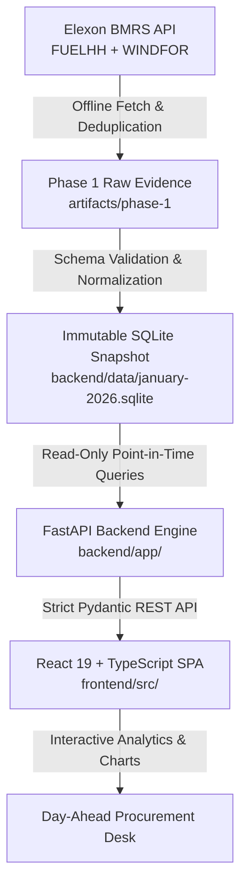

# REint — UK Day-Ahead Wind Forecast Intelligence

> An executive-grade intelligence and evaluation platform designed for UK electricity utilities operating in the day-ahead wholesale market, balancing weather-dependent renewable generation against thermal procurement using official Elexon market data.

[](https://www.python.org/)
[](https://fastapi.tiangolo.com/)
[](https://react.dev/)
[](https://www.typescriptlang.org/)
[](https://www.docker.com/)
[](tests/)
[](frontend/tests/)

---

## 1. Executive Summary & Problem Context

Energy utilities serving UK retail and commercial consumers must purchase electricity from the wholesale day-ahead market. To minimize costly imbalance settlement penalties and manage commodity risk:
- Power purchase decisions must be finalized **one day before the physical delivery day** (e.g., ahead of daily power auctions).
- Utilities rely heavily on **renewable generation forecasts** (specifically wind power) to calculate the residual volume of flexible thermal generation (CCGT, peakers) that must be procured.
- Because wind output is weather-dependent and volatile, power procurement desks require:
  1. **Strict point-in-time visibility:** Exactly what wind generation forecasts were published and available at the decision cutoff, without hindsight leakage.
  2. **Quantified forecast accuracy:** Empirical metrics (MAE, Bias, RMSE, P90 miss, net MWh energy error) across all delivery hours to size hedging buffers and avoid costly over/under-hedging.

### Scope of the January 2026 Pilot
- **Purchase Decision Window:** 1 January 2026 through 31 January 2026.
- **Physical Delivery Window:** 2 January 2026 through 1 February 2026 (each decision day targets the following calendar day).
- **Upstream Data Source:** Official Elexon BMRS public streams:
  - **Actuals:** `FUELHH/stream` filtered to `fuelType = "WIND"`.
  - **Forecasts:** `WINDFOR/stream` with explicit `publishTime` timestamps.

---

## 2. Key Product Capabilities

### 🔍 Decision Replay (Single-Day View)
- Reconstructs the exact information state of the procurement desk at any historical decision date and cutoff time.
- Guarantees **zero look-ahead bias**: only forecasts with `publishTime <= cutoff` are selected for next-day delivery.
- Interactive time-series delivery chart comparing forecast profile against retrospective actual generation.
- Signed hourly error chart distinguishing overforecasting (+MW, risk of underselling/thermal overcommitment) from underforecasting (-MW, risk of costly cashout imbalance).
- Decision desk briefing card displaying publication age (latency), eligible vintages, and pilot cutoff assumptions.

### 📊 January Review (Full-Month Intelligence)
- Pooled evaluation across all **744 delivery hours** of the pilot with **100% data coverage**.
- Aggregate metrics: **MAE (2,038.9 MW)**, **Bias (+1,747.9 MW overforecast)**, **RMSE (2,504.8 MW)**, **P90 Absolute Error (4,097.9 MW)**, and **Net Energy Error (+1,300,428 MWh)**.
- Daily performance ledger ranking each day's error, with 1-click **"Replay"** button jumping straight into that day's hourly profile.
- Single-click **CSV Export** generating a fully compliant 745-row audit dataset for external quantitative analysis.

### 🛡️ Enterprise Rigor & Accessibility
- Complete responsive design with 5 tailored breakpoints (1600px, 1200px, 1000px, 760px, 390px).
- Fully compliant with **WCAG 2.1 AA** accessibility standards (tested with `@axe-core/playwright`).
- Graceful error states (503 snapshot unavailable recovery, snapshot version mismatch detection, missing data gap rendering).

---

## 3. Architecture & Repository Layout



### File and Directory Manifest

| Path | Purpose |
| :--- | :--- |
| `Dockerfile` | Multi-stage production container (Node 22 build → Python 3.14 runtime with static SPA serving). |
| `docker-compose.yml` | Local orchestration mounting the validated snapshot and serving on port `8000`. |
| `.dockerignore` | Build-context optimization excluding dev artifacts, virtual environments, and caches. |
| `.gitignore` | Git rules keeping development temporary files clean while tracking the verified snapshot. |
| `backend/main.py` | FastAPI application entrypoint with production environment configuration. |
| `backend/app/api.py` | REST API routes (`/health`, `/api/metadata`, `/api/forecast`, `/api/evaluation`, static mount). |
| `backend/app/analytics.py` | Core mathematical evaluation engine (MAE, Bias, RMSE, P90 percentile, Net MWh energy error). |
| `backend/app/schemas.py` | Strict Pydantic v2 schemas defining verified response contracts. |
| `backend/app/data/cli.py` | Operational CLI supporting `build`, `inspect`, `select`, and `fetch` commands. |
| `backend/app/data/selection.py`| Point-in-time forecast selection and interval cadence alignment logic. |
| `backend/app/data/snapshot.py` | Atomic SQLite database builder with SHA-256 integrity verification. |
| `backend/app/data/normalization.py`| Half-open window validation, settlement period checks, and timestamp UTC conversion. |
| `backend/app/data/client.py` | Resilient Elexon HTTP client with exponential backoff and `Retry-After` header support. |
| `backend/tests/` | 38 automated test cases covering normalization, selection, API contracts, and edge cases. |
| `backend/data/january-2026.sqlite` | Curated, deterministic SQLite pilot database (SHA-256 validated). |
| `frontend/src/` | React 19 UI source (Components, hooks, types, API client, design system). |
| `frontend/src/components/` | Modular components (KPICards, GenerationChart, ErrorBarChart, DecisionControls, etc.). |
| `frontend/tests/dashboard.spec.ts`| Comprehensive Playwright test suite (Replay, month view, CSV export, a11y, mobile). |
| `artifacts/` | Retained raw Elexon evidence, validation results, screenshots, and OpenAPI schema. |
| `docs/architecture-review.md` | Deep-dive architectural review, roadmap, and design decisions. |
| `docs/data-contract.md` | Verified upstream Elexon data contract and interval definitions. |
| `docs/phase-2.md` | Data pipeline operations, deduplication rules, and validation evidence. |
| `docs/phase-3.md` | API contracts, mathematical proofs, and January verification benchmark. |

---

## 4. How to Start the Application

### Option A: Docker (Fastest, Production-Identical)

Prerequisites: [Docker Desktop](https://www.docker.com/products/docker-desktop/) installed and running.

```bash
# 1. Build and start the container
docker compose up --build

# 2. Access the application:
# Frontend Dashboard: http://localhost:8000
# Interactive API Docs: http://localhost:8000/docs
# Health Check: http://localhost:8000/health
```

To stop:
```bash
docker compose down
```

---

### Option B: Local Development (FastAPI + Vite)

#### 1. Backend Setup
Prerequisites: Python 3.14+ and [`uv`](https://github.com/astral-sh/uv).

```powershell
cd backend

# Install locked dependencies
uv sync --locked

# Verify or inspect the existing snapshot
uv run python -m app.data.cli inspect

# Run backend unit tests (38 tests)
uv run python -m unittest discover -s tests -v

# Start FastAPI development server
uv run fastapi dev main.py
```
*Backend runs at `http://127.0.0.1:8000` (docs at `http://127.0.0.1:8000/docs`).*

#### 2. Frontend Setup
Prerequisites: Node.js 22+ and `npm`.

```powershell
cd frontend

# Install dependencies
npm ci

# Run linter and typecheck
npm run lint
npm run build

# Start Vite dev server (automatically proxies /api to http://127.0.0.1:8000)
npm run dev
```
*Frontend runs at `http://localhost:5173`.*

---

### Option C: Re-fetching or Re-building the Data Snapshot

The pilot includes a pre-built, verified snapshot in `backend/data/january-2026.sqlite`. To rebuild offline from retained raw evidence:
```powershell
cd backend
uv run python -m app.data.cli build --source-dir ../artifacts/phase-1
```

To acquire fresh data from the public Elexon API:
```powershell
uv run python -m app.data.cli fetch --output-dir ../artifacts/phase-2-fetch
uv run python -m app.data.cli build --source-dir ../artifacts/phase-2-fetch
```

---

## 5. Verification & Test Suite

The project enforces quality at both the unit, integration, browser, and accessibility levels:

### 1. Backend Automated Tests (38/38 Passing)
```powershell
cd backend
uv run python -m unittest discover -s tests -v
```
- Tests include: look-ahead leakage prevention, cutoff inclusivity, duplicate resolution, half-hour actual averaging, missing data gap preservation, DST/timezone boundaries, 503 snapshot degradation, and metric mathematical parity.

### 2. Frontend & End-to-End Playwright Tests (8/8 Passing)
```powershell
cd frontend
npm run test:e2e
```
- Tests include:
  1. Day replay reconciliation with API values.
  2. Date + cutoff combined updates (including Feb 1 boundary).
  3. January monthly review and 745-row CSV export verification.
  4. 503 error recovery without stale data leakage.
  5. Missing pair handling with explicit null metrics and chart gaps.
  6. Snapshot version mismatch detection.
  7. Mobile responsive layout (390×844 viewport).
  8. Automated accessibility audit (WCAG 2.1 AA via Axe).

---

## 6. Analytical Methodology & Modeling Assumptions

| Topic | Implementation & Rationale |
| :--- | :--- |
| **Decision Cutoff** | Configurable (default `09:00 Europe/London`). Explicitly labeled as a pilot assumption rather than an official auction gate. |
| **Point-in-Time Forecast Selection** | For each target delivery hour, the system selects the latest forecast publication with `publishTime <= cutoff`. Hindsight revisions published after the cutoff are strictly excluded. |
| **Cadence Reconciliation** | WINDFOR forecasts are hourly; FUELHH actuals are half-hourly. Each delivery hour's actual MW is computed as the arithmetic mean of both constituent half-hours: `(HH1 + HH2) / 2`. If either half-hour is missing, the hour remains an explicit null gap (never zero-filled or silently interpolated). |
| **Error Direction Convention** | $\text{Error} = \text{Forecast} - \text{Actual}$. Positive values indicate **overforecasting** (wind came in lower than expected; utility risked thermal shortfall). Negative values indicate **underforecasting**. |
| **Net Energy Error (MWh)** | $\sum (\text{Error MW} \times 1.0\text{ h})$. Summarizes cumulative volumetric imbalance in megawatt-hours across the window. |
| **P90 Absolute Error** | Calculated using standard linear interpolation at index $0.9 \times (n - 1)$ of sorted absolute errors, quantifying high-impact tail risk. |
| **Pooled Monthly Metrics** | Monthly figures pool all 744 hourly pairs directly rather than taking an unweighted mean of daily averages, ensuring mathematically exact weighting. |
| **Scope Boundary** | Reflects GB national transmission-metered wind. Does not incorporate embedded solar, utility demand portfolios, or wholesale strike prices. |

---

## 7. Cloud Deployment Guide

The container is built as a single, self-contained multi-stage image where FastAPI serves the compiled React SPA at `/` and handles all REST API routes at `/api/*` and `/health`.

### Heroku Deployment (Container Registry)

```bash
# 1. Login to Heroku Container Registry
heroku login
heroku container:login

# 2. Create the Heroku application
heroku create <your-anonymous-app-name>

# 3. Build and push the container
heroku container:push web -a <your-anonymous-app-name>

# 4. Release the container
heroku container:release web -a <your-anonymous-app-name>

# 5. Open and verify in incognito mode
heroku open -a <your-anonymous-app-name>
```

### Live Application Link
- **Deployed Application URL:** `[INSERT LIVE DEPLOYED URL HERE]` *(e.g. `https://reint-wind-pilot.herokuapp.com`)*
- *Note: In accordance with instructions, please verify that this link opens and operates correctly in incognito mode.*

---

## 8. Deliverables & Video Walkthrough Guide

### Submission Checklist

- [x] **Working Source Code & Tests** (All backend and frontend suites passing).
- [x] **Containerization** (Multi-stage Dockerfile and docker-compose verified locally).
- [ ] **Public GitHub Repository** (Created with an anonymous name, e.g. `reint-wind-forecast-pilot`).
- [ ] **Cloud Deployment** (Deployed to Heroku or Render with live URL).
- [ ] **10-Minute Walkthrough Video** (Recorded and uploaded as unlisted YouTube video).
- [ ] **Microsoft Form Submission** (Submitted via [submission form](https://forms.cloud.microsoft/r/FTX6K2bbnU)).

### 10-Minute Video Structure (Guide for Presenter)

```
0:00 - 5:00 | PART 1: Client Presentation & Pilot Pitch
├── The Utility's Dilemma: Day-ahead market thermal procurement vs renewable volatility.
├── Live Product Demo:
│   ├── Decision Replay: 15 Jan case study, 09:00 cutoff, forecast profile vs actuals.
│   ├── Error Breakdown: Understanding overforecast (+352 MW) and tail risk (P90 = 1,341 MW).
│   ├── Decision Desk Briefing: Publication age, cutoff policies, and audit traceability.
│   ├── January Review: Monthly macro picture (744 hours, 100% coverage, net energy error).
│   └── Performance Ledger & CSV Export: Auditable data for quant risk modeling.
└── Business Value: Sizing hedging buffers, preventing imbalance penalties, actionable confidence.

5:00 - 10:00 | PART 2: Technical Lead Review & Architecture Walkthrough
├── Architecture & Data Flow: Elexon BMRS API → Resilient Client → Immutable SQLite → FastAPI → React SPA.
├── Data Modeling & Cadence: Resolving hourly WINDFOR with half-hourly FUELHH, handling gaps.
├── Point-in-Time Integrity: Proof of zero hindsight leakage via publishTime <= cutoff filtering.
├── Codebase Walkthrough:
│   ├── Backend: selection.py, analytics.py, strict Pydantic schemas, read-only transactions.
│   ├── Frontend: Tailwind v4 theme, Recharts synchronization, responsive layout, a11y.
│   └── Testing: 38 Python unit tests + 8 Playwright E2E tests + Axe accessibility checks.
└── Containerization & Operations: Multi-stage Docker build, $PORT binding, and zero-dependency snapshot.
```

- **Video Demo Link:** `[INSERT UNLISTED YOUTUBE VIDEO URL HERE]`

---

## 9. AI Assistance Disclosure

In full compliance with assignment instructions, **AI tools (OpenAI Codex and Google DeepMind Gemini)** were utilized during the execution of this project for:
- Initial requirement analysis and Elexon BMRS API documentation synthesis.
- Authoring data normalization routines, SQLite snapshot schemas, and analytics formulas.
- Scaffolding the React 19 / Vite dashboard components and Tailwind v4 design tokens.
- Generating comprehensive unit test cases and Playwright end-to-end browser scenarios.
- Authoring technical documentation and methodology reviews.

All modeling assumptions, cadence reconciliation logic, and mathematical formulations were reviewed and verified for domain correctness.
